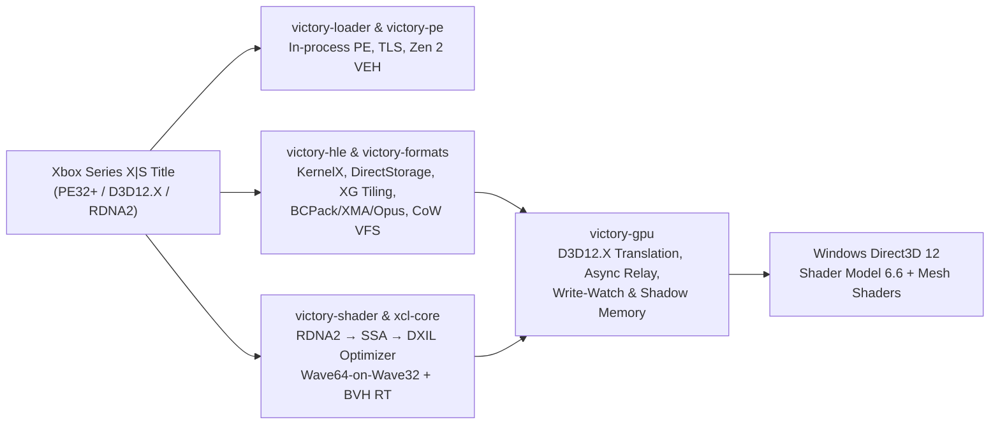
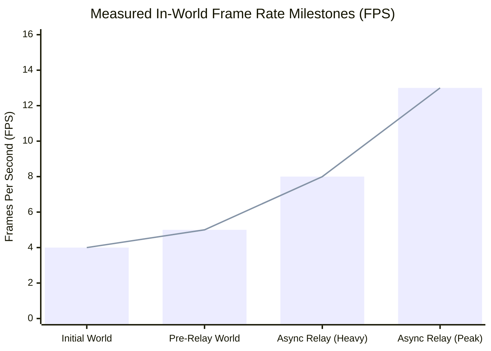
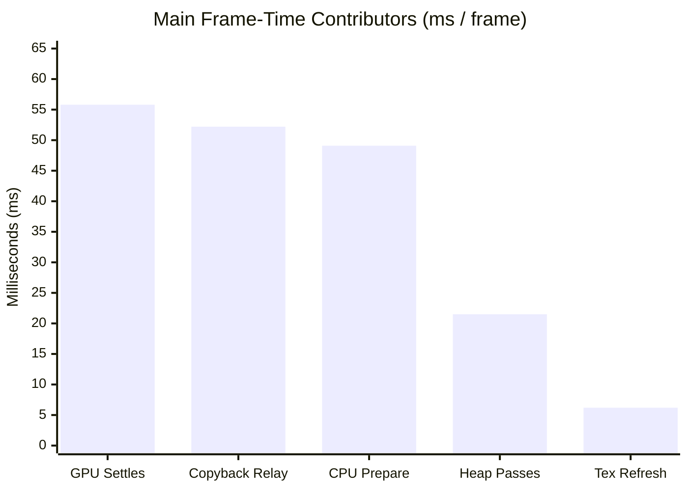
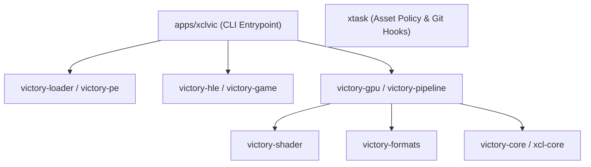

<div align="center">

# XBVK / XCLVIC

**Experimental Native Xbox Series X|S (`Scarlett` & `Victory`) Compatibility Layer for Windows**

[](Cargo.toml)
[](docs/architecture.md)
[-107C10)](crates/victory-gpu)
[](#current-status--performance)
[](#build-and-test)
[](LICENSE)

*Runs Xbox Series X|S x86-64 titles directly inside a Windows process, translating **D3D12.X** command streams and **RDNA2** shaders natively to **Windows Direct3D 12 (DXIL / Shader Model 6.6)**.*

[Architecture](#architecture) • [Status & Charts](#current-status--performance) • [Roadmap & Issues](#roadmap--tracked-issues) • [Build & Test](#build-and-test) • [CLI & Env Flags](#cli--environment-variables)

</div>

---

## Architecture

Instead of full-system emulation or Vulkan translation, **XCLVIC** maps console executables in-process on x86-64 Windows and translates console APIs and GPU work directly onto host D3D12:



---

## Current Status & Performance

> **Status: Pre-alpha** — Boot, menus, intro media, offline saves, character rendering, lighting, and initial **in-world gameplay run at ~8–13 FPS** on test hardware. Active work focuses on memory/commit headroom, partial-mip streaming, remaining compute/RT shaders, and GPU settle waits.

### In-World Frame Rate Progression



### Current Frame-Time Breakdown (Heavy World Scene, ~125 ms / 8 FPS)



### Subsystem Readiness

| Subsystem | State | Highlights |
|---|---|---|
| **PE Loader & Zen 2 Runtime** | 🟢 Working | In-process PE mapping, static TLS rewrite, `clzero`/`monitorx`/`mwaitx` VEH emulation, runtime hooks & `XCLVIC_PATCH`, `crashes.log` backtraces |
| **Console HLE & VFS** | 🟢 Working | `kernelx`, `xgameruntime`, `dstorage` & `files::fread` 1 MiB bounce reads, D3D12-ordered `xg` tiling, `gameinput`, `apu`/`audio`, `xmem`, `xstore`, `G:`/`T:` CoW VFS |
| **Texture & Audio Formats** | 🟢 Working | BCPack (BC7 entry-0 fix), fast const-generic GFX10 detiling/tiling, XMA/Opus audio decoding |
| **RDNA2 → DXIL Compiler** | 🟡 Active | DXIL optimizer (DCE/fold/reuse), worklist liveness, BVH RT lowering, Wave64-on-Wave32 compute (`VICTORY_LDS_FLAGS`, two-wave permutes, `v_permlane*`), 32 KiB mesh validation |
| **D3D12.X GPU Runtime** | 🟡 Active | Async relay (`VICTORY_RELAY=1`), AVX2 3-way readback merge, `VICTORY_COPY_COMPARE`, GPU card buffer hashing, `RwLock` descriptor cache, null-placed guards (`0 dropped`), depth twins |
| **VRAM / Commit & RT Builder** | 🚧 Bottleneck | Windows commit-charge pressure (`lack of room` stalls texture queue & partial-mip bakes), 4 refused `0x80070057` compute PSOs, stubbed RT structure builder, unimplemented slots `0x1c8`/`0x218` |

---

## Roadmap & Tracked Issues

All ongoing work is tracked in GitHub Issues:

| Issue | Focus Area | Progress | Next Milestones |
|---|---|---|---|
| [#3](https://github.com/0x0007b/XBVK/issues/3) | **Shader Stalls & PSO Hitching** | `2 / 4` | MRU early-warmup pipeline retention, adaptive `VICTORY_PIPELINE_BUDGET_MS`, RAM-bounded workers |
| [#4](https://github.com/0x0007b/XBVK/issues/4) | **TDR Timeouts & Frame Settles** | `2 / 5` | Cut ~55.5 ms `title memory read` GPU settle waits, `VICTORY_LIST_SPLIT`, `VICTORY_MESH_BUDGET`, spin-wait cap |
| [#5](https://github.com/0x0007b/XBVK/issues/5) | **Wave64-on-Wave32 & Mesh/Compute** | `2 / 6` | Mesh Wave64 emulation (`emulate_wave64`), output clamping, remaining 4 `0x80070057` compute PSOs, slots `0x1c8`/`0x218` |
| [#6](https://github.com/0x0007b/XBVK/issues/6) | **Textures, Readbacks & VRAM/Commit** | `2 / 5` | Fix commit-charge/VRAM eviction & partial-mip skin/LOD artifacts, `CopyTextureRegion` readback staging (`0xc0000409`) |
| [#7](https://github.com/0x0007b/XBVK/issues/7) | **Descriptors, Indirect & `xcl-core`** | `2 / 6` | Typed null descriptors, final null view-heap clamp, `ClearUnorderedAccessView*`, OOM mip-drop, `xcl-core` sync |

---

## Workspace Layout



| Crate / App | Responsibility |
|---|---|
| `apps/xclvic` | Unified CLI (`xclvic.exe`, built with `/HIGHENTROPYVA:NO` for `<2^40` console addressing) |
| `victory-core` | Config resolution (`victory.toml` / env), asset-policy guard, mirrored `latest.log` tracing |
| `victory-pe` | Read-only PE32+ and import-library analyzer |
| `victory-loader` | In-process PE mapping, static TLS, crash unwinder, Zen 2 instruction emulation, hooks & patching |
| `victory-hle` | Console API HLE (`kernelx`, `xgameruntime`, `dstorage`, `xg`, `gameinput`, `apu`/`audio`, `net`, `xmem`, `xstore`, `files` CoW VFS) |
| `victory-gpu` | D3D12.X runtime, async relay, write-watch & shadow memory, AVX2 merge, GPU card hashing, descriptor cache, UMA probing, diagnostics |
| `victory-shader` | Direct RDNA2 → SSA → DXIL compiler, DXIL optimizer, worklist liveness, BVH RT lowering, Wave64-on-Wave32 lowering |
| `victory-formats` | BCPack (BC7/etc.) decompression/encoding, GFX10 texture layouts & detiling, XMA/Opus decoding |
| `victory-pipeline` | Content-addressed asset conversion cache |
| `victory-game` | Title format decoders (`sgd5`), build IDs, and hooks |
| `xcl-core` | Secondary RDNA2 → HLSL → DXC compiler, GFX10 tiling tables, BVH/UMA helpers, CoW VFS, RPF9 tools |
| `xtask` | Asset-policy enforcement (`cargo xtask policy`) and git hook installer (`cargo xtask install-hooks`) |

**Technical Documentation:**
- [Architecture Overview](docs/architecture.md)
- [Asset Policy (Rule #1)](docs/asset-policy.md)
- [Relay Merge SIMD](docs/relay-merge-simd.md)
- [Indexed Relay Flights](docs/virex-indexed-relay-flights.md)
- [Worklist Register Liveness](docs/virex-worklist-liveness.md)

---

## Requirements

- **OS & CPU:** Windows 10/11 x64, AVX2-capable CPU, generous pagefile / commit headroom (24+ GiB recommended for world streaming).
- **GPU:** Direct3D 12 GPU with **Shader Model 6.6** and **Mesh Shaders**.
- **Toolchain:** Rust `1.88+` (`edition = "2024"`).

---

## Build and Test

```powershell
# 1. Verify repository asset policy
cargo xtask policy

# 2. Check and build workspace (plus diagnostics profile)
cargo check --offline --workspace --all-targets
cargo build --offline --workspace
cargo build --offline --profile diag -p xclvic --features diagnostics

# 3. Run unit & integration tests (no proprietary files required)
cargo test --offline --workspace -- --test-threads=4
```

Configure local title and cache paths outside the repository:

```powershell
copy victory.example.toml victory.toml
cargo run --offline -p xclvic -- config
```

---

## CLI & Environment Variables

Running with `--execute` writes automatic session diagnostics to `%LOCALAPPDATA%\victory\data\debug\`:
- `latest.log` — live mirrored tracing log
- `crashes.log` — unhandled exceptions and GPU device-removed reports
- `frames\` (`diag` profile) — `latest.png`, boot capture, periodic captures, and black-frame anomalies

<details>
<summary><strong>CLI Commands Reference</strong></summary>

```text
xclvic inspect <exe|dll> [--imports] [--exports]
xclvic census [paths...] [--missing] [--strict]
xclvic lib-exports <import.lib> [--list]
xclvic shader-info [paths...] [--verbose] [--disasm]
xclvic translate [paths...] [--validate] [--pipelines] [--list] [--jobs N] [--fallback]
xclvic disasm <file> [--offset N] [--length N] [--all] [--hex] [--fssm FILE]
xclvic shaders <file|folder|package.rpf> [--top N] [--json] [--recomp] [--compile N]
xclvic rpf <package.rpf> [--top N] [--find NAME] [--extract NAME --out DIR]
xclvic run [exe] [--execute] [--unimplemented trap|zero] [--strict] [--console series-x|series-s] [-- <title args>]
xclvic config
```

</details>

<details>
<summary><strong>Environment Variables — GPU Relay, Memory & Streaming</strong></summary>

| Variable | Effect |
|---|---|
| `VICTORY_RELAY=1` | Async GPU submission & copyback relay (`1` async stage, `2` exact relay) |
| `VICTORY_COPY_COMPARE=1` | Skip re-uploading unchanged title memory writes |
| `VICTORY_CARD_RESERVE=1`, `VICTORY_FULL_CARD_PASS=1` | VRAM headroom reservation and full-card texture slot holding |
| `VICTORY_CARD_BUFFERS_MIN_MB=<MB>`, `VICTORY_CARD_REHASH_RUNS=1` | GPU-side shader-write buffer scan threshold and coalesced card hash passes |
| `VICTORY_JOIN_COPIES=1`, `VICTORY_WIDE_REFRESH=1`, `VICTORY_WIDE_MERGE=0` | Adjacent copy coalescing, parallel texture refresh, parallel AVX2 readback merge toggle |
| `VICTORY_TEXTURE_NO_WAIT=1`, `VICTORY_EARLY_TEXTURES_MS`, `VICTORY_BAKE_TEXTURES_MS` | Non-blocking texture streaming and early/bake upload time budgets |
| `VICTORY_INPLACE_PROBE=1` | Probe host D3D12 support for `OpenExistingHeapFromAddress*` / UMA in-place heaps |

</details>

<details>
<summary><strong>Environment Variables — Shaders & Pipeline Cache</strong></summary>

| Variable | Effect |
|---|---|
| `VICTORY_HOST_WAVE=32` | Translate shaders for Wave32 host GPUs (enables Wave64-on-Wave32 compute lowering) |
| `VICTORY_LDS_FLAGS=1` | Toggle LDS flag-region lowering (`0` disables) for Wave64-on-Wave32 barriers |
| `VICTORY_VIEW_LIMIT=<N>` | Translate shaders assuming a capped host descriptor view heap slot limit |
| `VICTORY_SHADER_LOOP_LIMIT` | Loop iteration safety limit for translated shaders |
| `VICTORY_SKIP_PIPELINES=<hash,...>` | Skip draws/dispatches referencing specific 16-digit shader hashes |
| `VICTORY_LIBRARY_MAP=0`, `VICTORY_LIBRARY_HANDLE=0`, `VICTORY_LIBRARY_LOCK=1` | Fallback toggles for `ID3D12PipelineLibrary` mapping, file handles, and locking |
| `VICTORY_DXIL` | Override path to `dxil.dll` for `xclvic translate --validate` |
| `XCL_SPLIT_WAVE64`, `XCL_RECOMP_DXC`, `XCL_DUMP_HLSL` | Controls for `xcl-core` RDNA2 → HLSL → DXC tools |

</details>

<details>
<summary><strong>Environment Variables — Debugging, Diagnostics & Patching</strong></summary>

| Variable | Effect |
|---|---|
| `VICTORY_LOG` | Tracing level filter (e.g. `VICTORY_LOG=info,victory_gpu=debug`) |
| `VICTORY_D3D12_DEBUG=1` | Enable host D3D12 debug layer |
| `VICTORY_D3D12_GBV=1` | Enable GPU-based validation (slow, checks descriptor access) |
| `VICTORY_D3D12_DRED=1` | Enable DRED breadcrumbs and page-fault diagnostics |
| `VICTORY_D3D12_WARP=1` | Use Windows WARP software adapter (avoids GPU TDR resets) |
| `VICTORY_GPU_TIMING=1` | Per-list GPU timing and slowest command reporting |
| `VICTORY_CAPTURE`, `VICTORY_CAPTURE_FRAMES`, `VICTORY_CAPTURE_EVERY`, `VICTORY_DUMP_TARGETS` | Frame and render-target capture controls |
| `VICTORY_WATCH`, `VICTORY_CRASH_SAVE`, `VICTORY_STACKS`, `VICTORY_KEYS` | Memory watches, crash dumps, timed thread stacks, automated input |
| `XCLVIC_PATCH` / `XCL_PATCH` | Runtime byte patches (`<module>+0x<rva>:<old_hex>=<new_hex>;...`) |

</details>

---

## Asset Policy, Contributing & License

- **Zero-asset policy (Rule #1):** Never commit proprietary executables, game archives, extracted shaders, textures, or screenshots. Run `cargo xtask policy` before every commit.
- **Contributing:** Develop changes on focused branches (`fix/...`, `feat/...`, `perf/...`, `docs/...`) and open Pull Requests against `main` with root cause, affected crates, and test output.
- **License:** GPL-3.0-or-later — see [LICENSE](LICENSE). `crates/victory-formats/src/bcpack-tables.bin` carries the documented policy exception in [docs/asset-policy.md](docs/asset-policy.md).
